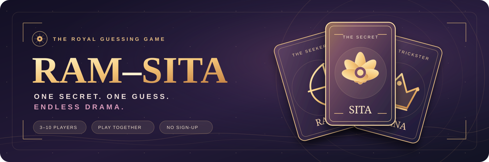
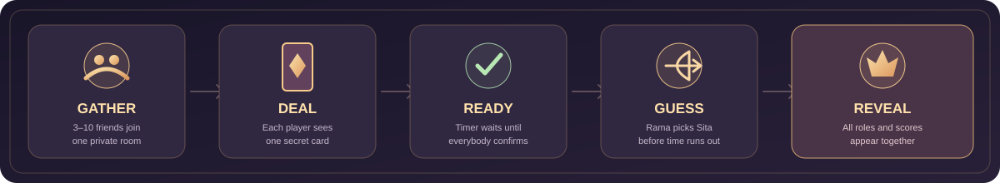

<div align="center">



<br />

### The childhood paper-chit game. Reimagined for your entire gang.

**Same room. Secret characters. One very suspicious friend.** 👑

An in-person, real-time multiplayer party game where everyone uses their own phone, but the real action happens **face-to-face**.

<br />

[](https://ram-sita-classic.onrender.com)
[](#-how-to-play)
[](#-under-the-hood)

<br />

[](https://github.com/Rishikeshsanin/Ram-sita/actions/workflows/ci.yml)
[](https://github.com/Rishikeshsanin/Ram-sita/actions/workflows/public-smoke.yml)


**[🎮 Play live](https://ram-sita-classic.onrender.com)** · **[📖 Game rules](#-how-to-play)** · **[🧪 Testing](docs/TESTING.md)** · **[🛠️ Contribute](CONTRIBUTING.md)**

</div>

---

## ✨ The game in a nutshell

Remember folding little paper chits, hiding your character, and trying *not* to laugh while Rama interrogated the room?

**That's Ram–Sita. No new gimmicks. Just the classic game, built for a group of friends with phones.**

| 🏹 **One seeker** | 🪷 **Secret identities** | 👑 **Maximum bluffing** |
| :--- | :--- | :--- |
| Rama gets **one final guess** to find Sita. | Everyone sees **only their own character** before the reveal. | Friends accuse, lie, defend themselves and laugh *in person*. |
| ⏳ **Fair rounds** | 🏆 **Live leaderboard** | 🔗 **Instant rooms** |
| Everyone checks their card **before** the countdown begins. | Points add up automatically; rematches keep the gang together. | Create a code, share a link, **no accounts required**. |

## 🎲 How to play



1. **Gather your friends.** The host creates a private room, chooses **3–10 players**, **3–30 rounds**, and a **20–90 second** guessing timer. Friends join by code or invite link and tap *I'm Ready*.
2. **Deal the secrets.** The host starts. Everyone privately flips their card to discover their character. **Rama's identity is public; everyone else's is secret.**
3. **Confirm your card.** Each player taps *I have seen my card — Ready!* The timer **does not start** until everyone confirms.
4. **Find Sita.** Everyone argues and bluffs out loud. Rama selects **one** suspected Sita before time runs out. No second guesses.
5. **Reveal the truth.** All cards flip, the server awards points, and the leaderboard updates. The host begins the next round. Highest total score wins; ties share the crown.

> **Classic Mode only.** No symbols, secret missions or alternate modes are mixed into the childhood rules.

### 🎭 Characters

The cast scales with the size of the room. Each round uses exactly one unique character per player:

| 3 players | Add as the group grows |
| --- | --- |
| 🏹 **Rama**, 🪷 **Sita**, 👑 **Ravana** | 🛡️ Lakshmana, 🐒 Hanuman, 🌿 Bharata, ⚔️ Shatrughna, 🦁 Sugriva, ✨ Vibhishana, 🦅 Jatayu |

The Rama role rotates fairly rather than repeatedly favoring the same player.

<details>
<summary><strong>🧮 Scoring (current house rules)</strong></summary>

<br />

Different families play Ram–Sita differently. This release uses **these house rules**:

| Character | Rama finds Sita | Wrong guess / timeout |
| --- | ---: | ---: |
| 🏹 Rama | **1,000** | **0** |
| 🪷 Sita | 200 | **800** |
| 👑 Ravana | 100 | 500 |
| Everyone else | 200 | 200 |

The server—not players' phones—calculates scores. Highest total wins; tied scores share placement.

</details>

## ⚡ Play or run it yourself

**[▶ Play Ram–Sita online](https://ram-sita-classic.onrender.com)** — best experienced with friends together, each on a separate device.

> [!NOTE]
> The demo runs on a **free Render web service**. First load may be slow after an idle period. Active rooms live in server memory, so a service restart or redeploy clears those rooms.

### Local setup

**Requirements:** Node.js **20+** and npm.

```bash
git clone https://github.com/Rishikeshsanin/Ram-sita.git
cd Ram-sita
npm install
npm start
```

Open **http://localhost:3000**. For nearby phones on the same Wi-Fi, use your computer's LAN IP (e.g. http://192.168.1.5:3000) with firewall access configured.

```bash
npm run check        # JavaScript syntax checks
npm test             # Game logic + three-client WebSocket tests
npx playwright install chromium
npm run test:browser # Chromium multiplayer and responsive tests
```

For browser-test setup and test coverage, see **[Testing](docs/TESTING.md)**.

## 🧠 Under the hood

<div align="center">

**Vanilla JavaScript** · **Node.js** · **WebSockets (ws)** · **HTML/CSS** · **Playwright** · **GitHub Actions** · **Docker** · **Render**

</div>

```text
Ram-sita/
├── assets/                 # Original branding + gameplay illustration
├── browser/                # 3-player Chromium end-to-end scenarios
├── docs/                   # Architecture, game rules and deployment
├── public/                 # Mobile-first game interface
├── src/
│   ├── game.js             # Roles, round state, fairness and scoring
│   └── server.js           # HTTP + WebSocket multiplayer server
├── smoke/                  # Public live-site smoke test
├── test/                   # Logic, secrecy and WebSocket tests
├── Dockerfile              # Single-service container
└── render.yaml             # Optional Render Blueprint
```

**Multiplayer is server-authoritative.** The backend shuffles roles, verifies the guess, keeps opponents' cards hidden and calculates scores. Phones only receive data their players are allowed to see.

| Quality gate | What it checks |
| --- | --- |
| [**Node CI**](https://github.com/Rishikeshsanin/Ram-sita/actions/workflows/ci.yml) | Syntax, unit/integration tests, real three-player Chromium match, mobile-width checks |
| [**Live smoke**](https://github.com/Rishikeshsanin/Ram-sita/actions/workflows/public-smoke.yml) | Public HTTP health + remote three-client WebSocket round |
| **Session recovery** | Reloading restores a seat while the same server instance is running |

This project intentionally needs **no login, database, microphone or camera**. For capacity and recovery limitations, see the docs below.

## 📚 Project handbook

| Guide | What's inside |
| --- | --- |
| [🎮 Game design & rules](docs/GAME_DESIGN.md) | What Classic includes, how a round works and what we're leaving out |
| [🏗️ Architecture](docs/ARCHITECTURE.md) | State machine, privacy, messages, host powers and room lifecycle |
| [🧪 Testing](docs/TESTING.md) | Commands, automated coverage and physical-device QA checklist |
| [🚀 Deployment](docs/DEPLOYMENT.md) | Render/Docker setup, health checks, hosting limitations and release verification |
| [🤝 Contributing](CONTRIBUTING.md) | How to propose a change without breaking Classic |
| [🔒 Security](SECURITY.md) | Trust boundaries and responsible reporting |

## 👑 Made to bring the group together

Ram–Sita isn't another game that traps everyone on their phones. **The screen holds the secret; your friends create the drama.**

Built by **[Rishikeshsanin](https://github.com/Rishikeshsanin)** · **[MIT License](LICENSE)**

<div align="center">

**One room. One Sita. One final guess.**

[**↑ Back to top**](#top) · [**Play now ↗**](https://ram-sita-classic.onrender.com)

</div>
